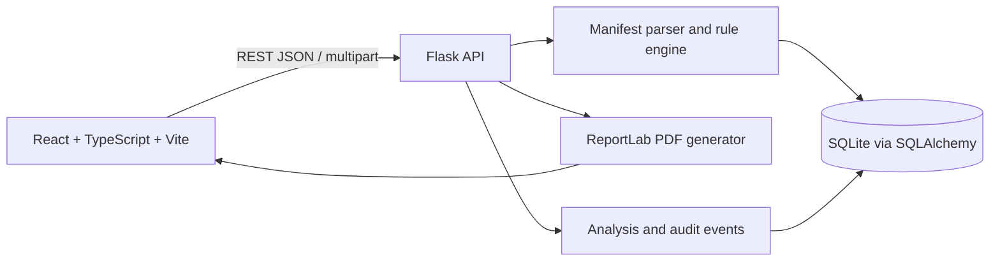

# BrowserGuard

**BrowserGuard — Intelligent Browser Extension Permission & Privacy Risk Analysis Platform**

BrowserGuard analyzes Chrome extension manifests without running extension code. It extracts declared permissions and host scopes, identifies configured sensitive combinations, provides explainable review-priority scores, persists results in SQLite, and generates PDF assessment reports.

The application is intended for cybersecurity education and analyst triage. Permission declarations describe potential capabilities; they do not prove that an extension exercises them. A score is not a probability of malware, and checklist results are not a compliance certification.

## Features

- Responsive charcoal, bronze, and burnt-orange analyst interface.
- Manifest JSON and ZIP upload; ZIP files are inspected in memory and never extracted or executed.
- Required/optional API permissions, host permissions, optional hosts, and content-script matches reported separately.
- Explainable permission and combination findings plus purpose-to-permission heuristic review.
- Configurable thresholds and weighted risk scoring.
- Persistent inventory, activity and audit records, settings, and generated-report records in SQLite.
- Extension filtering, detail review, comparison, sector grouping, PDF reports, and privacy checklist.
- A persistent synthetic benchmark that populates dashboards for evaluation and demonstration.
- An interactive publisher-location map that uses fictional benchmark metadata, not threat or user locations.

## Architecture



## Technology

- **Frontend:** React, TypeScript, Vite, Tailwind CSS, Lucide React, Recharts, React Router
- **Backend:** Python 3.10+, Flask, Flask-CORS, Flask-SQLAlchemy / SQLAlchemy
- **Database:** SQLite
- **Reports:** ReportLab
- **Tests:** pytest

## Project structure

```text
Specialization_Project/
├── backend/
│   ├── app/
│   │   ├── analyzers/       # Manifest classification, scoring, safe upload inspection
│   │   ├── models.py         # SQLAlchemy records
│   │   ├── reports.py        # PDF report generation
│   │   └── routes.py         # REST endpoints
│   ├── tests/
│   ├── config.py
│   ├── requirements.txt
│   └── run.py
├── database/                 # Created at runtime; SQLite persists here
├── frontend/
│   ├── src/
│   │   ├── components/
│   │   ├── pages/
│   │   └── services/         # Typed API client
│   └── package.json
├── venv/                     # Local Python environment (not required in source control)
└── README.md
```

## Requirements and setup

Use Python 3.10 or later and Node.js 20.19+ or 22.12+.

From the existing `Specialization_Project` directory, install backend dependencies:

```powershell
python -m venv venv
.\venv\Scripts\python.exe -m pip install -r backend\requirements.txt
```

Install frontend dependencies:

```powershell
Set-Location frontend
npm install
Set-Location ..
```

## Run the application

Start the API in one PowerShell terminal from the project root:

```powershell
.\venv\Scripts\python.exe backend\run.py
```

Start Vite in another PowerShell terminal:

```powershell
Set-Location frontend
npm run dev
```

Open the Vite URL printed in the terminal (normally `http://localhost:5173`). Vite proxies `/api` requests to `http://127.0.0.1:5000`. The API health check is `http://127.0.0.1:5000/api/health`.

The SQLite database is created at `database\browserguard.sqlite3`. Do not delete this file if you want to retain analysis records. Set `BROWSERGUARD_DATABASE_URL` to use another SQLAlchemy database URL, or `BROWSERGUARD_SECRET_KEY` to provide a deployment secret. The backend binds to loopback by default and has no authentication; keep it on a trusted local machine.

## Synthetic benchmark data

On first startup, BrowserGuard seeds 40 clearly labeled synthetic Manifest V3 profiles across 10 fictional sectors. The profiles are analyzed by the same manifest parser and rule engine used for uploads. Their fictional publishers and approximate country-level map coordinates are for interface and analysis testing only; they are not real organizations, users, locations, or threat origins. Benchmark profiles, findings, and scores are marked as synthetic in the application and reports.

The initialized database also includes 100 synthetic activity entries, 30 synthetic audit entries, and 15 stored example PDF reports. Health counts are available at `/api/health`. Seeding is idempotent and only runs when benchmark profiles are absent. To replace the benchmark profiles while preserving user-uploaded extension records, run from the project root:

```powershell
.\venv\Scripts\python.exe backend\seed_benchmark.py --reset
```

The dashboard, sector summaries, and map are derived from persisted records. Sector statistics represent only the stored analyses assigned to each sector; the synthetic benchmark is not an industry-wide sample.

## Manifest analysis workflow

1. Choose a `manifest.json` file (maximum 2 MB) or ZIP archive (maximum upload 16 MB).
2. The API validates the manifest fields and inspects a ZIP without extracting it. It rejects unsafe paths, encrypted archives, excessive entry counts, expansion sizes, and compression ratios.
3. The parser classifies declared API permissions, optional permissions, host permissions, optional host permissions, and content-script match patterns.
4. Configured rules explain sensitive permissions and selected combinations. A purpose description can mark likely relevance or request analyst justification; it does not prove that a permission is necessary or excessive.
5. The backend calculates a review-priority score, stores the manifest and evidence, and creates an audit event.
6. Analysts can inspect records, compare two extensions, and generate/download PDF reports. Uploaded JavaScript or other extension code is never executed.

## Risk scoring methodology

The score is an additive review-priority heuristic from 0 to 100:

| Contribution | Maximum | Basis |
|---|---:|---|
| Required permission sensitivity | 45 | Permission weights documented in `backend/app/analyzers/manifest.py` |
| Broad host scope | 25 | Required/optional broad hosts and content-script matches |
| Sensitive permission combinations | 20 | Configured, explainable co-occurrence rules |
| Purpose alignment | 10 | Unmatched sensitive required permissions when purpose text is supplied |

Optional-only combinations contribute half their combination weight until granted. Each contribution is capped before summing. The default score bands are Low 0–24, Moderate 25–49, High 50–74, and Critical 75–100. Analysts can change the three upper boundaries through Settings. Changes affect new analyses; stored scores are retained with their original results.

These are static manifest observations. BrowserGuard does not establish runtime use, malicious intent, malware probability, legal compliance, or geographic origin. Sector scores are averages of uploaded analyses explicitly assigned to that sector; they are not sector-wide statistics.

## API

All endpoints are under `/api`.

| Method | Endpoint | Purpose |
|---|---|---|
| GET | `/health` | API and database health |
| GET | `/overview?range=24h\|7d\|30d` | Database-derived dashboard, sector, and fictional publisher-location metrics |
| GET | `/extensions` | Search, filter, sort, and page inventory records |
| POST | `/extensions` or `/analyze` | Upload and analyze a manifest or ZIP |
| GET/DELETE | `/extensions/<id>` | Retrieve or delete one analysis |
| POST | `/extensions/<id>/reanalyze` | Recompute findings with current settings |
| POST | `/compare` | Compare two stored analyses |
| POST | `/compare/report` | Generate a comparison PDF |
| GET | `/permissions` | Permission catalog and analyzed declarations |
| GET | `/sectors` | Sector averages and review permissions |
| GET | `/activity`, `/audit` | Persistent activity and audit records; `/audit?format=csv` exports CSV |
| GET | `/reports` | Generated report records |
| POST | `/extensions/<id>/report` | Generate and download a PDF report |
| GET | `/reports/<id>/download` | Download a generated report again (`?inline=1` previews it) |
| GET/PUT | `/settings` | Read or update thresholds, score weights, permission weights, analysis, report, and upload settings |

The upload request is multipart form data with `file`, optional `purpose`, and optional `sector`. Errors return a JSON `error` message and an appropriate HTTP status.

## Database design

- **Extension:** manifest identity and JSON, separated permission declarations, permission detail, rule findings, combination evidence, purpose and privacy findings, score breakdown, SHA-256, risk classification, and timestamp.
- **AuditEvent:** analysis, report, deletion, and settings actions with JSON detail, category, severity, result, and timestamp.
- **SecurityReport:** generated PDF bytes and report metadata linked to an analysis.
- **Setting:** persisted configurable risk thresholds, weights, upload limits, report preferences, and analysis behavior.

Tables are initialized and upgraded on backend startup. Uploaded file bytes are not retained; ZIP content is read in memory and only the parsed manifest and its digest are persisted. Benchmark PDF reports are stored to make report preview and download available immediately.

## Tests and build

From the project root:

```powershell
.\venv\Scripts\python.exe -m pytest -c backend\pytest.ini
npm --prefix frontend run build
```

The backend tests cover permission rules and scoring, benchmark integrity and persistence, Manifest V2 host normalization, invalid JSON, safe ZIP inspection and traversal rejection, analysis persistence, metrics, reports, settings, and deletion.

## Limitations and future work

Analysis is static and rule-based; it does not inspect extension source code or runtime network behavior. Permission declarations indicate potential capabilities, not proven behavior, malicious intent, or malware probability. Purpose matching is keyword-based and requires human judgment. Fictional benchmark publisher coordinates are interface-only metadata and must not be interpreted as geographic origin or regional threat data. Authentication, team roles, remote reputation feeds, and broader browser-version compatibility testing are outside this local project scope.
